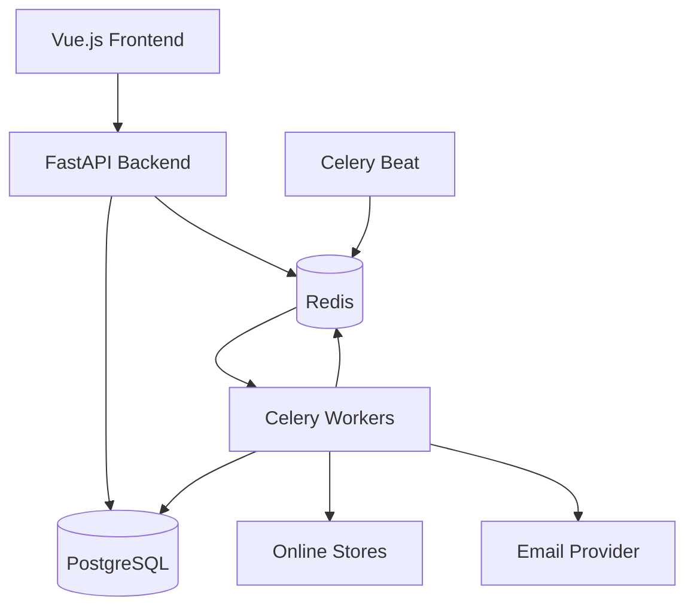

# Price Alerts

<p align="center">
  <strong>Automated Product Price Monitoring & Intelligent Price Notifications</strong>
</p>

<p align="center">
  Track products, monitor price changes, and receive notifications when your target price is reached.
</p>

---

## Overview

Price Alerts is a full-stack application designed to automate product price monitoring across online stores.

Users can add products, define target prices, track historical price changes, and receive email notifications when products reach their desired price. The system uses asynchronous background processing to handle price monitoring, data collection, alert evaluation, and notification delivery independently of API requests.

The platform is designed around modular backend architecture, reliable task processing, database integrity, and scalable monitoring workflows.

## Features

- User authentication and authorization
- Product tracking across supported online stores
- Custom target-price alerts
- Automated price monitoring
- Historical price tracking
- Price-drop detection
- Product availability monitoring
- Email notifications
- Asynchronous background processing
- Scheduled price-checking jobs
- Retry and failure handling
- Notification history
- RESTful API
- API documentation

## Architecture

The application separates client requests, business logic, persistence, background processing, and external integrations.



### System Components

| Component | Description |
|---|---|
| Vue.js | Interactive client application |
| FastAPI | API layer and application entry point |
| PostgreSQL | Persistent relational data storage |
| SQLAlchemy | ORM and database interaction |
| Alembic | Database schema migration management |
| Redis | Message broker, caching, and task coordination |
| Celery | Distributed background task processing |
| Celery Beat | Periodic task scheduling |
| HTTPX | HTTP communication with external services |
| Pydantic | Input validation and serialization |
| Docker | Containerization and environment management |
| Pytest | Automated testing |

## Price Monitoring Workflow

1. A user submits a product URL and configures a target price.
2. The backend validates the request and stores the tracking configuration.
3. A monitoring task is scheduled or queued.
4. A background worker retrieves the product information and current price.
5. The extracted data is validated and normalized.
6. The system stores the latest price and historical price record.
7. The alert engine evaluates configured price conditions.
8. Matching alerts trigger notification tasks.
9. The notification worker sends the email.
10. The notification result is recorded for tracking and retry handling.

## Technology Stack

### Frontend

- Vue.js
- JavaScript
- Vite

### Backend

- Python
- FastAPI
- Pydantic
- SQLAlchemy 2.0

### Database & Storage

- PostgreSQL
- Redis

### Background Processing

- Celery
- Celery Beat

### Data Collection

- HTTPX
- BeautifulSoup

### Authentication & Security

- JWT
- Password hashing
- Access and refresh tokens
- Resource ownership enforcement
- Request validation
- Rate limiting

### DevOps & Testing

- Docker
- Docker Compose
- Pytest
- GitHub Actions

## Database Design

The system uses a relational database to manage users, monitored products, alert configurations, price history, and notifications.

| Entity | Responsibility |
|---|---|
| User | Account and authentication information |
| Store | Supported online store configuration |
| Product | Product details and latest price |
| TrackedProduct | User-to-product tracking relationship |
| PriceAlert | User-defined alert conditions |
| PriceHistory | Historical price records |
| Notification | Notification delivery and status tracking |

### Relationships

- A user can track multiple products.
- A product can be tracked by multiple users.
- A store can contain multiple products.
- A product can have multiple historical price records.
- A user can create multiple alerts.
- An alert can generate multiple notification attempts.

## API

The backend exposes a versioned REST API.

| Module | Description |
|---|---|
| Authentication | Registration, login, token management |
| Users | User profile and account management |
| Products | Product tracking and management |
| Alerts | Target-price alert configuration |
| Price History | Historical prices and trends |
| Notifications | Notification history and delivery status |

### API Documentation

Interactive API documentation is provided through:

- Swagger UI — `/docs`
- ReDoc — `/redoc`

## Project Structure

```text
price-alerts-main/
├── backend/
│   ├── app/
│   │   ├── api/
│   │   ├── core/
│   │   ├── db/
│   │   ├── models/
│   │   ├── schemas/
│   │   ├── repositories/
│   │   ├── services/
│   │   ├── workers/
│   │   ├── scrapers/
│   │   └── main.py
│   ├── tests/
│   ├── alembic/
│   ├── Dockerfile
│   └── pyproject.toml
│
├── frontend/
│   ├── src/
│   ├── public/
│   └── package.json
│
├── docker-compose.yml
├── .gitignore
└── README.md
```

## Reliability & Engineering

The backend is designed with reliability and data consistency in mind.

- Asynchronous execution for long-running operations
- Retry strategies for transient failures
- Request and task timeouts
- Database transaction management
- Idempotent background task design
- Duplicate notification prevention
- Separation of application and infrastructure concerns
- Structured logging
- Health checks
- Automated testing

## Security

- Secure password hashing
- JWT-based authentication
- Protected endpoints
- User-level authorization
- Resource ownership verification
- Input validation
- Environment-based configuration
- Rate limiting
- Secure secret management

## Running Locally

### Prerequisites

- Python 3.12+
- Node.js
- Docker
- Docker Compose

### Backend

```bash
cd backend
python -m venv .venv
```

Activate the virtual environment:

**Windows**

```powershell
.venv\Scripts\Activate.ps1
```

**Linux/macOS**

```bash
source .venv/bin/activate
```

Install backend dependencies:

```bash
pip install -e .
```

### Frontend

```bash
cd frontend
npm install
npm run dev
```

### Infrastructure

```bash
docker compose up --build
```

Environment configuration is managed through environment variables. Refer to `.env.example` for required settings.

## Testing

The project uses Pytest to validate application behavior across different layers.

Test coverage includes:

- Authentication and authorization
- API validation
- Database operations
- Product tracking
- Price extraction
- Alert evaluation
- Background tasks
- Notification delivery
- Failure and retry behavior

Run the test suite:

```bash
pytest
```

## License

MIT License
