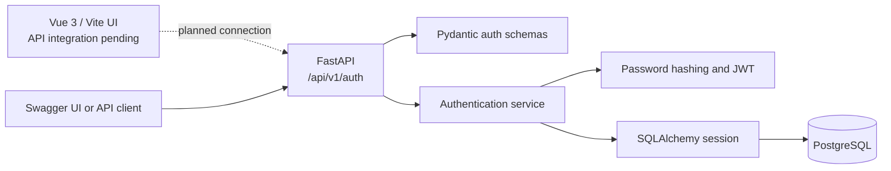

# Price Alerts — Technical Architecture

## 1. Current status

The backend currently implements account registration and login. The Vue/Vite frontend contains screens and a login prototype, but it does not yet call the authentication API. Product tracking, scheduled price collection, price history, and notifications are planned components, not current services.

## 2. Current system

## 3. Backend responsibilities

- `app/main.py` creates the FastAPI application, registers the authentication router under `/api/v1`, and creates ORM tables during application startup.
- `app/api/auth.py` maps HTTP requests to registration and login operations and translates expected failures into HTTP responses.
- `app/schemas/auth.py` validates request data and defines response shapes.
- `app/services/auth_service.py` performs user lookup, registration, and credential verification.
- `app/core/security.py` hashes and verifies passwords and signs JWT access tokens.
- `app/core/config.py` loads `backend/.env` without overriding environment variables already set by the process.
- `app/db/session.py` reads `DATABASE_URL`, creates the SQLAlchemy engine, and provides request-scoped database sessions.
- `app/models/user.py` defines the current `users` table.

The `repositories/` and `utils/` directories are currently empty. Authentication service functions query the database directly.

## 4. Authentication request flow

### Registration

1. `POST /api/v1/auth/register` receives email and password input.
2. Pydantic validates the input.
3. The service checks that the email is not already registered.
4. The password is hashed before persistence.
5. The response includes the new user's public ID and email, not the password hash.

### Login

1. `POST /api/v1/auth/login` receives email and password input.
2. The service looks up the user and verifies the password hash.
3. Invalid credentials produce a generic `401 Unauthorized`.
4. Valid credentials produce a signed JWT with the user's ID as its subject and an expiry.

The API issues access tokens, but there are not yet protected product endpoints or a shared current-user dependency.

## 5. Data model

The current ORM model is `User`:

| Field | Purpose |
| --- | --- |
| `id` | Primary key |
| `email` | Unique account email |
| `hashed_password` | Password hash; never the original password |
| `created_at` | Account creation time |

Product, price observation, and alert models do not exist yet.

## 6. Configuration and data safety

- `DATABASE_URL` and `JWT_SECRET_KEY` are read from the ignored local `backend/.env` file or the process environment.
- Never commit `.env` or paste its values into documentation, logs, screenshots, or issue reports.
- Password hashes are generated with `pwdlib`; JWTs are signed with HS256 and expire after 30 minutes.
- The database URL should use credentials appropriate to the local or deployed database environment.

## 7. Planned architecture extensions

The product requirements anticipate:

- Product and user-owned watch records.
- Price observation history.
- Scheduled price collection with retries and observable failures.
- Notification delivery and user preferences.
- Authorization checks ensuring users can access only their own data.

The job scheduler, scraping/provider strategy, queue, and notification provider have not yet been selected or implemented. Do not treat them as available features.
